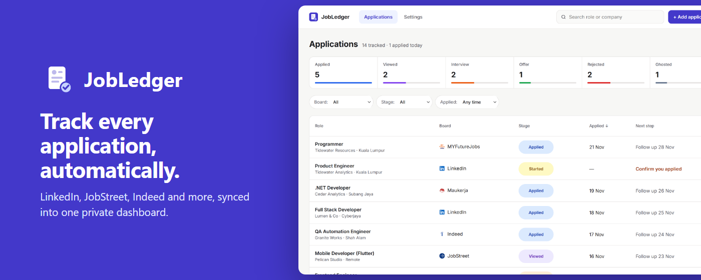
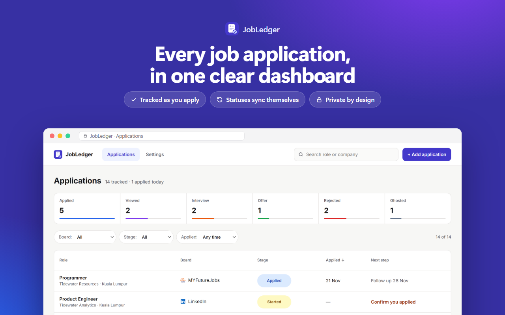
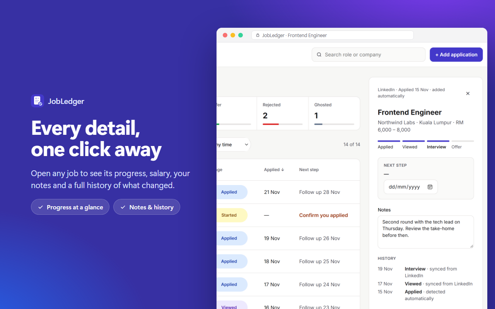
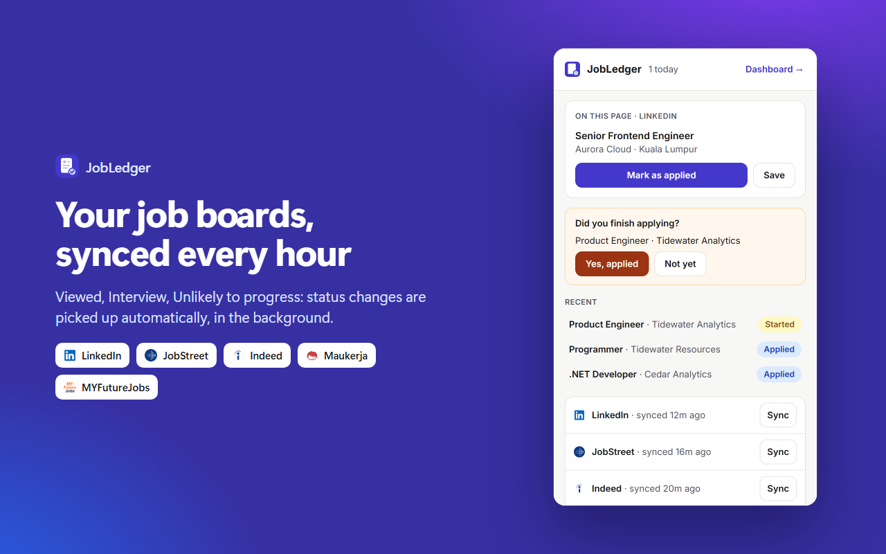
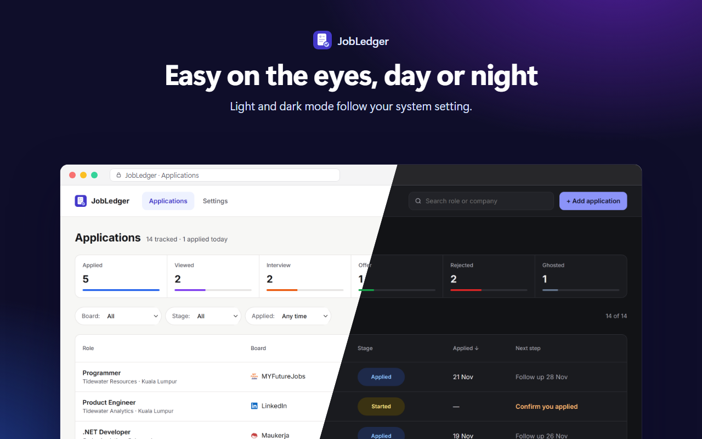
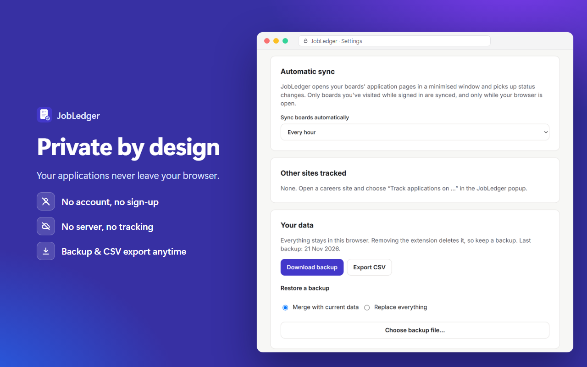

  

<h1 align="center">JobLedger</h1>

  <b>Every job you apply to, in one place, without spreadsheets.</b> 
  A browser extension for Microsoft Edge and Google Chrome that records your job applications automatically and keeps their status up to date.

  

> **Note:** This repository is a showcase. The source code is private.

---

## What it does

JobLedger notices when you apply for a job and records it for you: title, company, location, salary, job description and link. It then reads your job boards' "My applications" pages to keep every application's status current, so you can see at a glance what's waiting, what's moving and what to do next.

**Works with:** LinkedIn · JobStreet / JobsDB / SEEK · Indeed · Maukerja · MYFutureJobs · and any company careers site you turn on.

## Features

- **Automatic tracking.** Apply as usual and the job is recorded. If JobLedger isn't sure you finished applying, it asks.
- **Status sync.** Statuses such as Viewed, Interview and "Unlikely to progress" are read from your boards and turned into stages. Optional background sync checks every hour in a minimised window.
- **One-click import** of applications made before installing.
- **Dashboard** with stage counts, a "Next step" column, filters, and search that tolerates typos.
- **Side panel per job** with progress, notes, job description and a full change history.
- **Reminders** to follow up, and quiet applications are marked Ghosted automatically.
- **Backup, restore and CSV export.**
- **Light and dark mode.**
- **Private by design.** Data stays in the browser: no server, no account, no tracking.

## Screenshots

*Screenshots use made-up sample data.*

## How it's built

| Area | Technology |
|---|---|
| Extension platform | Manifest V3 (service worker, content scripts, `chrome.alarms`, `chrome.storage`) |
| UI | React 19, TypeScript, hand-written CSS design tokens with light and dark themes |
| Storage | IndexedDB via Dexie, entirely on the device |
| Build | Vite with CRXJS; a dependency-free script packs the store zip |
| Tests | Vitest + jsdom, 330+ tests |

Highlights:
- **Per-board page readers** that turn each job board's "My applications" page into structured data, plus a general reader for any careers site.
- **Background sync** that opens boards in a minimised window, reads them and closes it, with timeouts and retry handling.
- **Matching and de-duplication** so the same job seen on different pages, or imported twice, becomes one application.
- **Status-word mapping** from each board's wording ("Unlikely to progress", "Shortlisted", …) to a common set of stages.

## Install

Coming soon to Microsoft Edge Add-ons and the Chrome Web Store.

## Privacy

JobLedger stores everything locally in your browser and sends nothing to anyone. See the [privacy policy](PRIVACY.md).

---

JobLedger is an independent project, not affiliated with or endorsed by LinkedIn, SEEK/JobStreet, Indeed, Maukerja or MYFutureJobs.

© 2026 JobLedger. All rights reserved.
